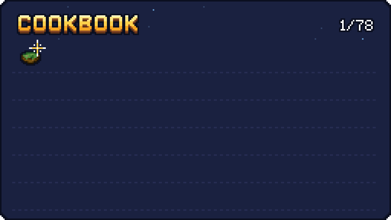

<p align="center"></p>

<p align="center">
  
  
  
  
</p>

**Dishes from the Stardew Valley cookbook, cooked the Farmer's Delight way.** 78 new dishes with buffs based on Stardew, cooked in
the cooking pot, at the crafting table and on the cutting board. The mod page text is in
[`docs/description.md`](docs/description.md).

<p align="center"></p>

# Stardew Delight — аддон для Farmer's Delight

Вся еда из Stardew Valley, переделанная из мода **Stardew Kitchen** в аддон для **Farmer's Delight**.

* **Minecraft 1.18.2 – 26.3** на **Forge, NeoForge и Fabric** — по файлу на каждую версию, см. таблицу ниже
* Требуется **Farmer's Delight**; на Fabric — **Farmer's Delight Refabricated** и **Fabric API**
* Нужен и на клиенте, и на сервере

## Версии
| Minecraft | Загрузчик | Файл | Проверено с Farmer's Delight |
|---|---|---|---|
| 26.3 | Fabric | `stardewdelight-fabric-26.3-1.0.0.jar` | Refabricated 26.3-3.6.30, Fabric API 0.166.2 |
| 26.2 | Fabric | `stardewdelight-fabric-26.2-1.0.0.jar` | Refabricated 26.2-3.6.30, Fabric API 0.161.0 |
| 26.1 – 26.1.2 | Fabric | `stardewdelight-fabric-26.1-1.0.0.jar` | Refabricated 26.1-3.6.30, Fabric API 0.155.3 |
| 1.21.11 | Fabric | `stardewdelight-fabric-1.21.11-1.0.0.jar` | Refabricated 1.21.11-3.6.16, Fabric API 0.141.6 |
| 1.21.9 – 1.21.10 | Fabric | `stardewdelight-fabric-1.21.10-1.0.0.jar` | Refabricated 1.21.10-3.4.2, Fabric API 0.138.4 |
| 1.21.6 – 1.21.8 | Fabric | `stardewdelight-fabric-1.21.8-1.0.0.jar` | Refabricated 1.21.8-3.3.3, Fabric API 0.136.1 |
| 1.21.5 | Fabric | `stardewdelight-fabric-1.21.5-1.0.0.jar` | Refabricated 1.21.5-3.2.5, Fabric API 0.128.2 |
| 1.21.1 | NeoForge | `stardewdelight-neoforge-1.21.1-1.0.0.jar` | 1.21.1-1.3.4, NeoForge 21.1 |
| 1.21.1 | Fabric | `stardewdelight-fabric-1.21.1-1.0.0.jar` | Refabricated 1.21.1-3.3.6, Fabric API 0.116.18 |
| 1.20.1 | Forge, NeoForge | `stardewdelight-forge-1.20.1-1.0.0.jar` | 1.20.1-1.3.4, Forge 47 / NeoForge 47.1 |
| 1.20.1 | Fabric | `stardewdelight-fabric-1.20.1-1.0.0.jar` | Refabricated 1.20.1-2.5.7, Fabric API 0.92.12 |
| 1.19.2 | Forge | `stardewdelight-forge-1.19.2-1.0.0.jar` | 1.19.2-1.2.4, Forge 43 |
| 1.18.2 | Forge | `stardewdelight-forge-1.18.2-1.0.0.jar` | 1.18.2-1.2.3, Forge 40 |

Во всех версиях одинаковые 78 блюд, рецепты, эффекты и текстуры. Каждая сборка проверена на выделенном сервере
самотестом: все 78 рецептов загрузились, каждое блюдо съедено (эффекты и возвращаемая тара), Иммунитет блокирует и
снимает дебаффы.

## Что изменилось по сравнению со Stardew Kitchen
* Блюда готовятся в **кастрюле Farmer's Delight** (супы, рагу, горячие блюда), на **верстаке** (салаты, выпечка, бутерброды) и на **разделочной доске** (сашими).
* В рецептах используются продукты FD: лук, помидоры, капуста, рис, тесто, паста, томатный соус, корж для пирога, дольки тыквы, яичница и т. д.
* Подача как в FD: супы, рагу, салаты и все вторые блюда (категория `meals`) — **в миске**, стак 16, миска возвращается;
  напитки — в стеклянной бутылке; снеки (бутерброды, тако, пицца, роллы) и выпечка едятся с руки.
  Кастрюля сама просит миску/бутылку как тару, на верстаке миска — один из ингредиентов.
* Сохранены все баффы Stardew, плюс эффекты FD: **Уют** (Comfort) у супов и **Сытость** (Nourishment) у вторых блюд в миске.
  Салаты, сладкое, снеки и напитки — без них, как у самого Farmer's Delight.
* Текстуры нарисованы в стиле Farmer's Delight: та же деревянная миска и широкая миска для вторых блюд, стеклянная кружка
  для напитков, отступы по краям, контуры тёмным оттенком своего цвета, без чистого белого и чёрного.
* В рецептах — общие теги загрузчика, как у самого FD: на Forge — `#forge:crops/carrot`, `#forge:crops/potato`,
  `#forge:crops/onion`, `#forge:raw_fishes/cod`, `#forge:milk` и т. д., на NeoForge и Fabric — `#c:crops/carrot`,
  `#c:crops/onion`, `#c:drinks/milk`, `#c:foods/dough` и т. д., поэтому подходят культуры и рыба из других модов.
* Свои эффекты **Магнетизм** и **Иммунитет к дебаффам** сохранены.
* Блюда добавлены в теги FD `farmersdelight:meals / sweets / snacks / drinks`.
* «Яичница» и «Хлеб» не дублируются — используются `farmersdelight:fried_egg` и `minecraft:bread`. Получается 78 собственных блюд + 2 из FD/ванили = все 80.
* Рецепты открываются в книге рецептов, как только подобран любой ингредиент.

## Сборка
Один исходник на все версии — [Stonecutter](https://stonecutter.kikugie.dev/) 0.10: Forge через ModDevGradle Legacy,
NeoForge через ModDevGradle, Fabric через Loom. Сам Gradle запускается на **JDK 25** (этого требует Stonecutter),
JDK 17 / 21 / 25 для компиляции каждой версии Gradle скачает сам через toolchain.
```
dev\gw.bat buildAndCollect                   # все версии (JDK 25 берётся из %JDK25%; Linux/macOS: JAVA_HOME=<JDK 25> ./gradlew buildAndCollect)
dev\gw.bat :1.21.1-fabric:buildAndCollect    # одна версия
python dev/build_all.py                      # все версии по очереди, сводка и лог каждой в build/logs/
python dev/check_jars.py                     # проверка готовых jar без запуска игры
```
Готовые jar: `build/libs/1.0.0/stardewdelight-<загрузчик>-<версия MC>-1.0.0.jar`.
Версия, открытая в IDE, переключается задачей `"Set active project to 1.21.1-fabric"` (по умолчанию — 26.3-fabric).
Версии, загрузчики и зависимости — в `settings.gradle.kts` и `stonecutter.properties.toml`, различия кода между
версиями — комментарии Stonecutter `//? if >=1.21.2 {` прямо в исходниках.

Самотест на сервере: запустите сервер с `-Dstardewdelight.selftest=true` — после старта в лог попадёт строка
`SELFTEST DONE: 158 ok, 0 failed` (78 рецептов, 78 блюд, 2 проверки Иммунитета).

Первый запуск после клонирования (достаёт переводы и иконки эффектов из jar Stardew Kitchen, рисует текстуры блюд,
качает Gradle wrapper, генерирует код, данные и оформление):
```
python tools/bootstrap.py "../StardewKitchen/stardewkitchen-1.0.0.jar"
```

Список блюд (`Dishes.java`), модели и языки, а для каждой версии — рецепты, достижения, теги, определения предметов и
`pack.mcmeta` в формате своей версии Minecraft и своего загрузчика (`versions/<версия>/generated`) генерируются скриптом
`tools/gen.py`:
```
python3 tools/gen.py
```
Сытость, тара и эффекты блюд — в `tools/items.json`, рецепты, категории FD и эффекты Comfort/Nourishment — в `gen.py`.
`gen.py` заодно проверяет правила FD (блюда из `meals` — в миске, снеки — без тары, у рецептов на верстаке есть миска,
тара на текстуре совпадает с тарой предмета) и останавливается с понятной ошибкой, если что-то разошлось.

Текстуры блюд рисуются скриптом `tools/fd_textures.py` (нужен Python 3 с Pillow): у каждого блюда — тара, пиксельный шаблон
и цвета, свет и тени считаются автоматически:
```
python3 tools/fd_textures.py                        # перезаписать текстуры мода
python3 tools/fd_textures.py out --sheet sheet.png  # отрисовать в папку out и собрать сводный лист для проверки
```

## Рецепты
| Блюдо | Где | Ингредиенты | Голод |
|---|---|---|---|
| Омлет | Кастрюля | яйцо, яйцо, молоко (ведро/бутылка) | 4 |
| Хашбраун | Кастрюля | картофель, картофель, лук | 4 |
| Блины | Верстак | тесто, яйцо, молоко (ведро/бутылка) | 4 |
| Полный завтрак | Верстак | яичница (FD), молоко (ведро/бутылка), Хашбраун, Блины, миска | 8 |
| «Обед фермера» | Верстак | Омлет, морковь, листовой салат (капуста), миска | 8 |
| Тройной эспрессо | Кастрюля | какао-бобы, какао-бобы, какао-бобы + бутылка | 1 |
| Имбирный эль | Кастрюля | морковь, морковь, сахар, бутылка мёда + бутылка | 3 |
| Суп из пастернака | Кастрюля | морковь, морковь, молоко (ведро/бутылка), лук + миска | 3 |
| Овощное ассорти | Кастрюля | помидор, свёкла, морковь + миска | 7 |
| Жаркое из фасоли | Кастрюля | семена тыквы, семена тыквы, томатный соус (FD), лук + миска | 5 |
| Суп том кха | Кастрюля | тропическая рыба, коричневый гриб, молоко (ведро/бутылка), лук + миска | 7 |
| Уха из форели | Кастрюля | сырой лосось, ламинария, лук + миска | 4 |
| Суп из водорослей | Кастрюля | ламинария, ламинария, ламинария + миска | 3 |
| Светлый бульон | Кастрюля | сушёная ламинария, сушёная ламинария, костная мука + миска | 5 |
| Тыквенный суп | Кастрюля | долька тыквы (FD), долька тыквы (FD), молоко (ведро/бутылка), лук + миска | 8 |
| «Дары осени» | Кастрюля | долька тыквы (FD), картофель, морковь, сахар + миска | 9 |
| Рыбная похлебка | Кастрюля | сырая треска, картофель, молоко (ведро/бутылка), лук + миска | 9 |
| Биск из омара | Кастрюля | тропическая рыба, тропическая рыба, молоко (ведро/бутылка), помидор + миска | 9 |
| Уха | Кастрюля | любая сырая рыба, любая сырая рыба, любая сырая рыба, помидор, лук + миска | 9 |
| Пои | Кастрюля | картофель, картофель, картофель, картофель + миска | 3 |
| Тропическое карри | Кастрюля | рис, ломтик арбуза, какао-бобы, огненный порошок + миска | 6 |
| Ризотто с папоротником | Кастрюля | рис, папоротник, лук, молоко (ведро/бутылка) + миска | 9 |
| Стир-фрай | Кастрюля | морковь, коричневый гриб, капуста, светящиеся ягоды + миска | 8 |
| Клюквенный соус | Кастрюля | сладкие ягоды, сладкие ягоды, сахар + миска | 5 |
| Рисовый пудинг | Кастрюля | рис, молоко (ведро/бутылка), сахар + миска | 5 |
| Сливовый пудинг | Кастрюля | яблоко, яблоко, пшеница, сахар + миска | 7 |
| Морской пенный пудинг | Кастрюля | любая сырая рыба, любая сырая рыба, чернильный мешок, молоко (ведро/бутылка) + миска | 7 |
| Банановый пудинг | Кастрюля | светящиеся ягоды, молоко (ведро/бутылка), сахар + миска | 5 |
| Манговый клейкий рис | Кастрюля | ломтик арбуза, рис, молоко (ведро/бутылка), сахар + миска | 5 |
| Мороженое | Верстак | молоко (ведро/бутылка), сахар, снежок, миска | 4 |
| Салат | Верстак | листовой салат (капуста), одуванчик, яблоко, миска | 5 |
| Салат из редиса | Верстак | свёкла, свёкла, листовой салат (капуста), миска | 8 |
| Капустный салат | Верстак | капуста, свёкла, яйцо, миска | 9 |
| Фруктовый салат | Верстак | сладкие ягоды, ломтик арбуза, яблоко, миска | 11 |
| Креветочный коктейль | Верстак | тропическая рыба, помидор, морковь, миска | 9 |
| Цветная капуста с сыром | Кастрюля | капуста, молоко (ведро/бутылка), молоко (ведро/бутылка) + миска | 6 |
| Запеченная рыба | Кастрюля | любая сырая рыба, любая сырая рыба, пшеница + миска | 3 |
| Жареный кальмар | Кастрюля | чернильный мешок, чернильный мешок, тесто | 3 |
| Жареные грибы | Кастрюля | коричневый гриб, красный гриб, лук + миска | 5 |
| Глазированный батат | Кастрюля | картофель, сахар, бутылка мёда + миска | 8 |
| Карповый сюрприз | Кастрюля | сырая треска, сырая треска, сырая треска, сырая треска + миска | 4 |
| Ужин из лосося | Кастрюля | сырой лосось, капуста, лук + миска | 5 |
| Окунь с хрустящей корочкой | Кастрюля | сырая треска, тесто, подсолнух + миска | 4 |
| Перечные бомбочки | Кастрюля | огненный порошок, молоко (ведро/бутылка), помидор | 5 |
| Спагетти | Кастрюля | сырая паста, помидор, помидор + миска | 3 |
| Жареный угорь | Кастрюля | сырая треска, подсолнух + миска | 3 |
| Острый угорь | Кастрюля | сырая треска, огненный порошок + миска | 5 |
| Красное блюдо | Кастрюля | свёкла, свёкла, капуста, яблоко + миска | 10 |
| Баклажаны с пармезаном | Кастрюля | помидор, свёкла, молоко (ведро/бутылка), тесто + миска | 7 |
| Чудо-блюдо | Кастрюля | капуста, сладкие ягоды, папоротник + миска | 6 |
| Коренья на блюде | Кастрюля | морковь, картофель, светящиеся ягоды + миска | 5 |
| Артишоковый дип | Кастрюля | папоротник, молоко (ведро/бутылка), лук + миска | 4 |
| Жареный фундук | Кастрюля | семена тыквы, семена тыквы, семена тыквы | 7 |
| Эскарго | Кастрюля | слизь, лук, подсолнух + миска | 9 |
| Крабовые котлетки | Кастрюля | тропическая рыба, тесто, яйцо, подсолнух | 9 |
| Равиоли с чернилами кальмара | Кастрюля | чернильный мешок, тесто, помидор + миска | 5 |
| Странная булочка | Кастрюля | тесто, любая сырая рыба, плод хоруса | 4 |
| Обед на удачу | Верстак | морской огурец, Тортилья, василёк | 4 |
| Тортилья ×3 | Верстак | тесто, тесто | 2 |
| Пицца | Верстак | тесто, томатный соус (FD), молоко (ведро/бутылка) | 6 |
| Рыбное тако | Верстак | жареная рыба, Тортилья, капуста, помидор | 7 |
| «Морское блюдо» | Верстак | жареная рыба, жареная рыба, Хашбраун, миска | 6 |
| «Бургер для выживания» | Верстак | хлеб, морковь, светящиеся ягоды, лист капусты (FD) | 5 |
| Брускетта | Верстак | хлеб, помидор, подсолнух | 5 |
| «Объеденье» | Верстак | хлеб, сладкие ягоды, Жареный фундук, миска | 7 |
| Суши-роллы | Верстак | любая сырая рыба, сушёная ламинария, варёный рис (FD) | 4 |
| «Шахтерский леденец» | Верстак | светящиеся ягоды, светящиеся ягоды, сахар, молоко (ведро/бутылка) | 5 |
| Шоколадный торт | Верстак | тесто, какао-бобы, какао-бобы, сахар, яйцо, молоко (ведро/бутылка) | 6 |
| Розовый торт | Верстак | тесто, ломтик арбуза, ломтик арбуза, сахар, яйцо | 10 |
| Пирог с ревенем | Верстак | корж для пирога (FD), сахарный тростник, сахарный тростник, сахар | 9 |
| Тыквенный пирог | Верстак | корж для пирога (FD), долька тыквы (FD), сахар, бутылка мёда | 9 |
| Черничный тарт | Верстак | корж для пирога (FD), сладкие ягоды, сладкие ягоды, яйцо | 5 |
| Ежевичный коблер | Верстак | тесто, сладкие ягоды, сладкие ягоды, сладкие ягоды, сахар | 7 |
| Печенье ×4 | Верстак | тесто, сахар, яйцо | 4 |
| Клюквенная сласть | Верстак | сладкие ягоды, яблоко, сахар, сахар | 5 |
| Маффин с маком | Верстак | тесто, мак, сахар | 6 |
| Кленовый пончик | Верстак | тесто, бутылка мёда, сахар | 9 |
| Сашими ×2 | Разделочная доска (нож) | тропическая рыба | 3 |

## Оформление страницы мода
Анимированные иконка и баннер, заголовки разделов, разделитель, промо-плашка и ролик «Cookbook» в стиле страниц Profet:
пиксель-арт 1:1, сцена — медная кастрюля на костре под звёздным небом, из которой по очереди выпрыгивают блюда мода.
```
python3 dev/art/make_art.py                     # всё сразу (или по отдельности:)
python3 dev/art/make_icon.py                    # docs/icon-animated.gif (256 px, ≤256 КиБ) и .webp, docs/icon-512.png, логотип мода
python3 dev/art/make_banner.py                  # docs/banner.png / .gif / .webp (1536×512)
python3 dev/art/make_desc.py                    # docs/desc/title-*.png/.webp, docs/desc/divider.*, docs/promo-tile.*
python3 dev/art/make_clips.py                   # docs/clips/cookbook.gif / .webp — все блюда мода
python3 dev/art/make_description.py <URL>       # docs/description.md и .html
```
`<URL>` — адрес, где лежит папка `docs/` (например, `https://raw.githubusercontent.com/<ник>/stardew-delight/main`).
Нужен Python 3 с Pillow и numpy. Блюда берутся из текстур мода — после перерисовки текстур просто перезапустите скрипты.
Иконка для CurseForge/Modrinth — `docs/icon-animated.gif` (или `docs/icon-512.png`), баннер — `docs/banner.gif`.
