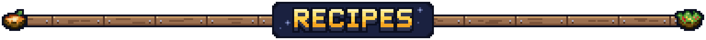

**Dishes from the Stardew Valley cookbook, cooked the Farmer's Delight way: in the cooking pot, on the cutting board and at the crafting table.**

Stardew Delight is an add-on for **Farmer's Delight** that adds **78 dishes from Stardew Valley**. Fried Egg and Bread are not duplicated: recipes use Farmer's Delight's Fried Egg and vanilla Bread instead. Available for **Forge** 1.18.2, 1.19.2 and 1.20.1, **NeoForge** 1.21.1 and **Fabric** 1.20.1, 1.21.1, 1.21.5 – 1.21.11 and 26.1 – 26.3. Requires Farmer's Delight on Forge and NeoForge, Farmer's Delight Refabricated and Fabric API on Fabric.

- **78 dishes.** From Hashbrowns and Pancakes to Lobster Bisque, Pink Cake and the Complete Breakfast. Every dish has its own texture drawn in Farmer's Delight's style.
- **Three ways to cook.** 48 dishes simmer in the cooking pot, 29 are made at the crafting table, and Sashimi is sliced on the cutting board.
- **Farmer's Delight ingredients.** Recipes use onions, tomatoes, cabbage, rice, cooked rice, wheat dough, raw pasta, tomato sauce, pie crust, pumpkin slices and Fried Egg.
- **Served like Farmer's Delight food.** Bowl dishes stack to 16 and give the bowl back, the cooking pot asks for a bowl to serve them. Triple Shot Espresso and Ginger Ale come in a glass bottle. Sandwiches, tacos, pizza, rolls and baked goods are eaten by hand.
- **Buffs based on Stardew.** Stardew stat buffs become Minecraft effects: Farming and Mining → Haste, Fishing → Luck, Luck → Hero of the Village, Foraging → Jump Boost, Defense → Resistance, Attack → Strength, Speed → Speed, Max Energy → Absorption. Some dishes get an extra effect that suits them, such as Water Breathing on seafood, Fire Resistance on spicy food and Regeneration on cakes and pies.
- **Comfort and Nourishment.** Soups and other warm bowl dishes give Farmer's Delight's **Comfort**, hearty main courses give **Nourishment**.
- **Two new effects.** **Magnetism** pulls dropped items and XP orbs to you (5 blocks, +3 per level). **Debuff Immunity** removes harmful effects and blocks new ones while it lasts.
- **Strange Bun** teleports you to a random spot nearby, like a chorus fruit.
- **Tooltips.** Every dish shows its hunger, saturation and effects with their durations.

| Dish | What it gives |
| --- | --- |
| **Miner's Treat** | Haste III, Night Vision, Magnetism |
| **Seafoam Pudding** | Luck IV, Water Breathing, Dolphin's Grace |
| **Complete Breakfast** | Haste II, Absorption II, Nourishment |
| **Spicy Eel** | Speed, Fire Resistance, Hero of the Village, Nourishment |
| **Lobster Bisque** | Luck III, Water Breathing, Absorption II, Comfort |
| **Triple Shot Espresso** | Speed II, Haste |
| **Squid Ink Ravioli** | Haste, Debuff Immunity, Nourishment |
| **Strange Bun** | Night Vision and a random teleport |

- **Cooking pot:** Parsnip Soup (carrot ×2, milk, onion), Tom Kha Soup (tropical fish, brown mushroom, milk, onion), Tropical Curry (rice, melon slice, cocoa beans, blaze powder), Fiddlehead Risotto (rice, fern, onion, milk) and 44 more.
- **Crafting table:** Pizza (wheat dough, tomato sauce, milk), Complete Breakfast (fried egg, milk, Hashbrowns, Pancakes, bowl), Fish Taco (cooked fish, Tortilla, cabbage, tomato), Rhubarb Pie (pie crust, sugar cane ×2, sugar) and 25 more.
- **Cutting board:** Sashimi, two from a tropical fish with a knife.

A recipe appears in the recipe book as soon as you pick up one of its ingredients. All dishes are in the **Stardew Delight** creative tab.

- Dishes and the original idea: **Stardew Valley** by ConcernedApe. This is an unofficial fan-made mod and is not affiliated with ConcernedApe.
- **Farmer's Delight** by vectorwing.

Stardew Delight is released under the **MIT License**.

